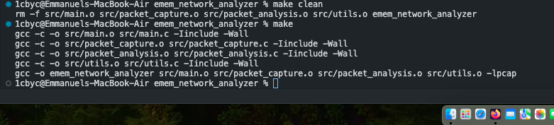

> **Licensing update (31 October 2026):** The current policy requires prior written permission for reuse and a separate agreement for AI training. See [LICENSE](LICENSE). Earlier grants remain valid for previously licensed material; [LICENSE.previous](LICENSE.previous) preserves those terms. Any older license descriptions below describe the previous policy. Contact [ei@nsisong.com](mailto:ei@nsisong.com).

# yes, it is emem's network analyzer. my baby!

okay, back to why i am doing this. this is actually a tool to help me with capturing and analyzing network packets. good thing is that i did it in a way that it supports inspecting different types of network protocols and even analyzing traffic patterns too. crazy stuff!

if you intend to use this with me, keep in mind it can do these three things mostly:
1. packet capturing
2. traffic pattern analysis
3. protocol inspection

had some issues with my packet analysis script but i am done with it. you can check my commit history to know what i did. or wait till i explain it.

well, after the whole rectification, this is the result as i ran my build:



now it is time to run the operation after i have completed build. 

if you dey use my code, just do:
```bash
sudo ./emem_network_analyzer
```

let me come back later to this analyzer. i willfix some crazy logic and functionalities to the packet_analysis sha. make ah come back first.
though what i have in mind is to implement specific parsing protocols i so please, and maybe if there is still excitement i will make it to capture packes directly into a file.

## dont play with me; <br> who goes you?!
